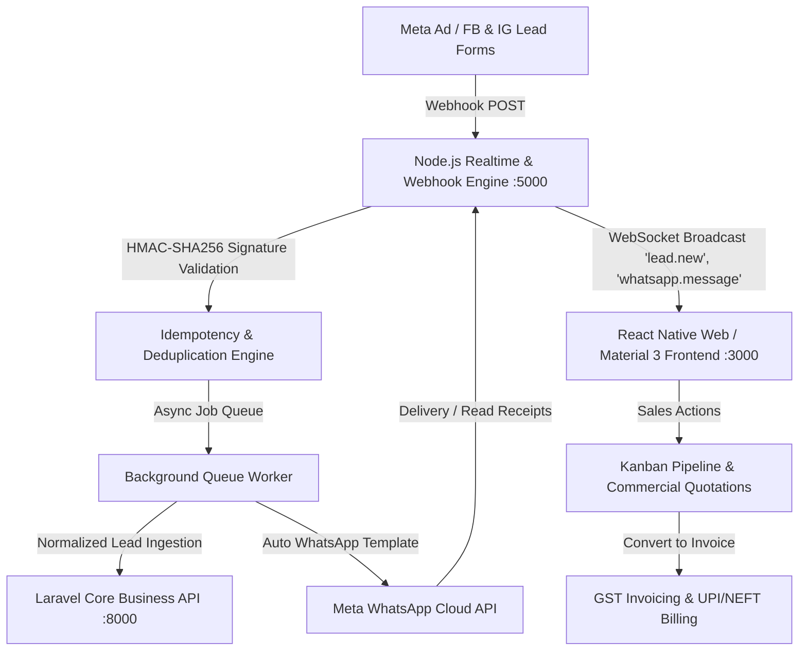

# Myth Connect.ai — Enterprise Architecture & Integration Guide

**Brand Tagline**: `CONNECT | CONVERT | AUTOMATE | SALES`  
**Version**: 1.0.0 Production  
**Platform**: Centralized Omnichannel CRM, Meta Lead Capture, WhatsApp Automation, Quotations, Invoices & Smart Dynamic QR Management

---

## 1. System Overview

Myth Connect.ai is an enterprise SaaS platform engineered to convert Meta (Facebook & Instagram) ad leads into closed sales through automated WhatsApp Cloud API cadences, sales pipeline management, formal quotations, GST tax invoicing, and dynamic QR attribution.



---

## 2. Monorepo Project Structure

```
/mythconnect
├── /frontend               # React Native Web + TypeScript + React Native Paper (Vite)
│   ├── /src
│   │   ├── /components     # AppHeader, AppSidebar, MobileNavigation, CommandPalette, MetaSimulationModal
│   │   ├── /screens        # Dashboard, Leads, LeadDetail, WhatsAppCRM, Followups, Pipeline, Customers, Quotes, Invoices, Billing, QR, Reports, Team, Integrations, Settings, Login
│   │   ├── /store          # Zustand global state (auth, navigation, domain datasets, mutations)
│   │   ├── /services       # Axios REST client, Realtime WebSocket client, Simulation endpoints
│   │   ├── /theme          # Myth Connect Brand tokens (#1565E8, #EF1D2D, #00A86B, #F5A000, #0B1F3A)
│   │   └── /types          # Complete TypeScript domain contracts
├── /backend-node           # Meta & WhatsApp Communication Gateway (Express + WebSocket + Queues)
│   ├── /src
│   │   ├── /controllers    # WebhookController, SimulationController
│   │   ├── /routes         # webhookRoutes, simulationRoutes, apiRoutes
│   │   ├── /services       # metaService, whatsappService, realtime socketManager, jobQueue, webhookDispatcher
│   │   └── /config         # Environment configuration
├── /backend-laravel        # Core Enterprise Business Backend (PHP 8.2 + Laravel 11 + Sanctum)
│   ├── /app
│   │   ├── /Http/Controllers # LeadController, CustomerController, QuotationController, InvoiceController, PaymentController, AuthController
│   │   └── /Models          # Lead, Customer, Quotation, Invoice, Payment, Followup, WhatsAppMessage
│   └── /routes              # api.php (Comprehensive REST endpoints)
├── /database               # Database Definitions
│   ├── schema.sql          # 514 lines normalized MySQL 8.0+ / MariaDB schema
│   └── seeds.sql           # Realistic Indian B2B seed data (10 leads, 5 customers, 5 quotes, 5 invoices, 10 followups, 5 chats, QR records)
└── /docs                   # Technical architecture & API references
```

---

## 3. Brand Design System

| Brand Token | Hex Code | Purpose |
| :--- | :--- | :--- |
| **Primary Blue** | `#1565E8` | Primary brand actions, active navigation, links, and CTAs |
| **Dark Navy** | `#0B1F3A` | Brand header, typography, primary headings, professional backdrop |
| **Accent Green** | `#00A86B` | Won pipeline deals, paid invoices, WhatsApp status, success states |
| **Accent Red** | `#EF1D2D` | Overdue follow-ups, lost leads, error badges, destructive actions |
| **Accent Orange** | `#F5A000` | Quotation stage, pending reminders, warnings |
| **Neutral Surface** | `#F8FAFC` / `#FFFFFF` | Clean SaaS canvas avoiding visual clutter |

---

## 4. Meta Lead Gen to Closed Sale Sequence

1. **Prospect Action**: User fills instant lead form on Facebook/Instagram.
2. **Webhook Dispatch**: Meta dispatches webhook `POST` to `/webhooks/meta`.
3. **Signature Verification**: Node.js calculates `HMAC-SHA256(rawBody, META_APP_SECRET)` against `X-Hub-Signature-256`.
4. **Deduplication Check**: Phone number and `leadgen_id` checked in idempotency cache. If phone exists, customer record is updated instead of duplicated.
5. **CRM Ingestion**: Lead saved to database with source `'meta'`, campaign name, form name, and priority `'high'`.
6. **Automation Trigger**: Message queue executes automated welcome WhatsApp template (`myth_lead_welcome`) via WhatsApp Cloud API.
7. **Cadence Setup**: 2-hour pending follow-up scheduled for assigned sales specialist.
8. **Realtime Broadcast**: WebSocket event `lead.new` pushed to all active CRM agent desktops.
9. **Sales Outreach**: Sales executive connects on WhatsApp/Call, negotiates scope, and issues quotation with 18% GST.
10. **Invoice & Settle**: Quotation converted into formal tax invoice with 1-click balance tracking and UPI/bank reference recording.
